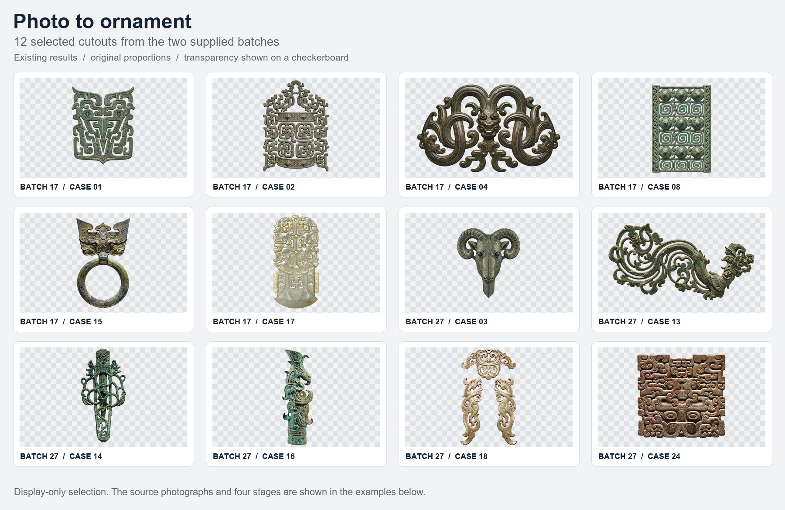
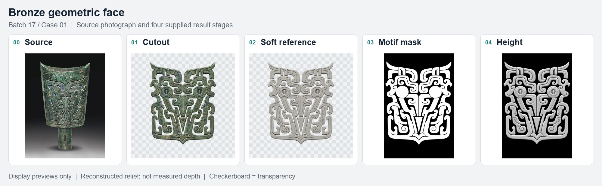
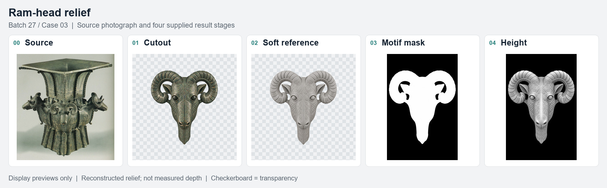
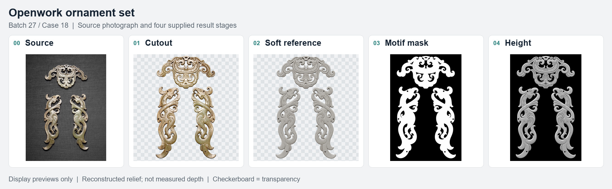
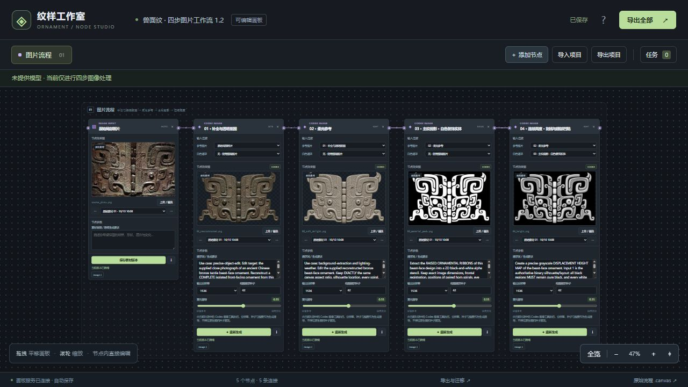
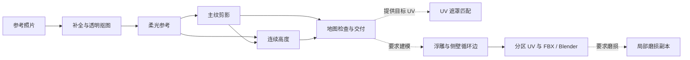

<div align="center">

# Photo to Ornament

### 照片转纹样 Skill · 纹样节点工作台

**从参考照片到纹样地图，再按需制作 UV 与浮雕。**

[技能入口](SKILL.md) · [安装与运行](references/runtime.md) · [节点工作台](references/workbench.md) · [图像流程](references/photo-maps.md)

</div>



将补全抠图、柔光参考、白色主纹剪影、连续高度图整理为可复用的 Codex Skill。仓库同时包含可运行的本地节点工作台、批量任务约定、图像检查脚本，以及按需使用的 UV 和 Blender 浮雕流程。

## 四步，从照片到地图

| 阶段 | 交付 | 要点 |
| --- | --- | --- |
| 01 补全与透明抠图 | 完整纹样 PNG | 保留可见结构，按需补足裁切边缘，真实透明背景 |
| 02 柔光参考 | 结构参考 PNG | 减弱反光与偏色，保留细刻线和读形明暗 |
| 03 主纹剪影 | 黑底白色装饰实体 | 刻线与眼部凹陷保留支撑，指定负空间才留黑 |
| 04 连续高度 | 同布局灰度高度图 | 连续坡度、主次起伏与浅刻线，保持与剪影对齐 |

下图从左到右为 **原照片 → 补全抠图 → 柔光参考 → 主纹剪影 → 连续高度**。







展示图取自提供的 17 项和 27 项批次，是已有成果的等比例缩小排版；[来源与校验信息](assets/showcase/provenance.json) 随仓库保存。原图补全及生成高度属于艺术重建，不是测量深度。展示图不代替原尺寸生产地图。

## 纹样节点工作台



在浏览器中管理原图与四步节点，编辑提示词、连接上游输入、查看每次生成的版本、恢复选定版本、上传素材及导出资料。需要时可添加 UV、密度引导、局部铺排或 Blender 节点。

图像节点保存请求和版本，可由当前 Codex 聊天执行，也可由本机 OpenAI 兼容 API 执行器调用服务商并回填。已有示例可直接查看；仓库不内置账号、额度或 API 密钥。

## 生图模型与接口接入

| 路径 | 模型与接入 |
| --- | --- |
| 已有示例 / Codex 聊天 | 原工作台请求标签为 `Codex image 2`；工具未记录实际模型 ID，具体版本未知 |
| OpenAI 兼容 API | 支持 GPT Image 系列及兼容模型；示例使用 `gpt-image-1.5`，实际模型由本机配置决定 |

在终端运行 `python scripts/run_image_api_secure.py --check`，按提示填写服务地址、模型和 Key。Key 不回显且不写文件；检查不调用生图服务。工作台建立任务后，使用 `python scripts/run_image_api_secure.py --job 任务ID` 执行并回填。完整的环境变量、独立编辑命令、接口格式和费用说明见 [生图模型与 API 接入](references/image-api.md)。

密钥仅由本机执行器读取，不进入浏览器、项目 JSON、导出包或仓库。接口地址也不写入生成记录；详情见 [凭据保护与检查范围](SECURITY.md)。

## 安装 Skill

仓库根目录就是完整技能目录，无需原来的大型工程包。

```sh
git clone --depth 1 https://github.com/42-ghx/photo-to-ornament-workflow.git
cd photo-to-ornament-workflow
python scripts/install_skill.py
```

默认安装到 `$CODEX_HOME/skills/photo-to-ornament`，未设置时使用 `~/.codex/skills/photo-to-ornament`。已有同名技能会先整体备份。也可直接将整个仓库目录复制到所用客户端的技能目录，并将文件夹命名为 `photo-to-ornament`。

在能发现此技能的新聊天中调用：

> 使用 $photo-to-ornament，把这些器物照片制作成补全抠图、柔光参考、主纹剪影和连续高度图，并在纹样节点工作台整理版本。

## 启动工作台

使用 Python 3.11 或更新版本（推荐 3.12），先在选定的虚拟环境安装依赖：

```sh
python -m pip install -r setup/requirements-studio.txt
python setup/start_studio.py
```

依赖就绪后，Windows 可双击 `launch_studio.cmd`；macOS / Linux 执行 `sh launch_studio.sh`。启动器优先使用已存在的 `.venv-studio` / `.venv`，也可用 `ORNAMENT_PYTHON` 指定 Python 环境。默认访问 `http://127.0.0.1:8001/`。

## 完整工作流与扩展



| 能力 | 使用方式 |
| --- | --- |
| 批量四步 | 每张独立编号、提示词、版本与状态；见 [批量交付](references/batch.md) |
| 地图数值检查 | `python scripts/inspect_maps.py --maps <目录>` |
| OBJ 现有 UV 抽取 | `python scripts/extract_uv_mask.py --obj <模型.obj> --out <新目录>` |
| UV 匹配与局部重复铺排 | 按本次目标区域和用户要求开启；见 [UV 说明](references/uv-matching.md) |
| 密集浮雕、底厚、侧壁、UV、FBX | 安装可选几何依赖和 Blender；见 [几何流程](references/geometry.md) |
| 局部磨损 | 内含节点资产及脚本，按需建立区域权重；见 [磨损说明](references/wear.md) |

## 包内结构

```text
SKILL.md                 技能入口与适用范围
agents/                  客户端展示信息
references/              地图、批量、工作台、UV、几何与磨损指南
scripts/                 安装、地图检查、UV抽取、网格与导出脚本
canvas/                  完整节点工作台及测试
setup/                   工作台启动器与依赖
assets/                  节点资产与轻量展示图库
cases/taotie/            工作台初始四阶段示例
```

运行时结果写入被 Git 忽略的 `runs/`。当前版本不包含旧完整包、历史运行目录或大型 Before / FBX / Blender 高模成果。图片默认流程完成到四步，额外铺排、UV、建模与磨损由本次请求决定。

## 验证

打包时使用 Python 3.12 完成工作台与 API 接口测试：51 项中 48 项通过，3 项因 Windows 符号链接权限或缺少历史模型而跳过。API 使用模拟服务验证，未进行付费调用。另以 64×64 遮罩和 16 位高度图验证完整几何链路：生成 8,520 个四边面，保留贯通孔；Blender 5.2.1 LTS 完成渲染、保存与 FBX 重导入，坐标、UV 和尺寸误差为 0。此结果验证小样本链路，不代表任意输入自动通过验收。

```sh
python -m unittest discover -s canvas/tests -v
node --check canvas/studio.js
```

数值检查能发现尺寸、透明度、灰度、文件结构和范围问题；纹样语义、细节保留与艺术补全仍需查看图片。几何验收使用当前生成的报告，不能以历史案例记录替代。
