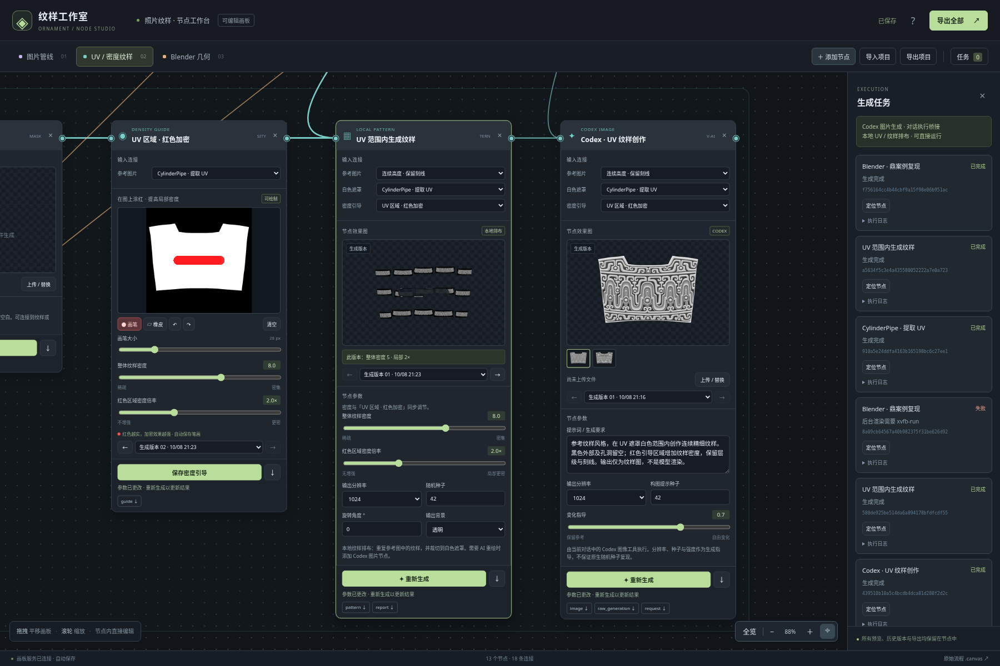
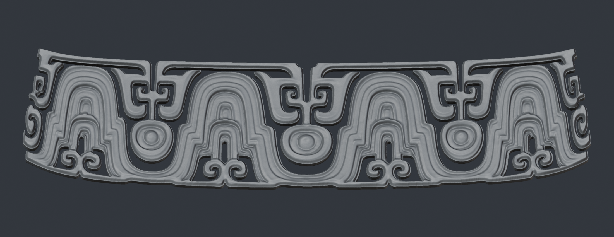
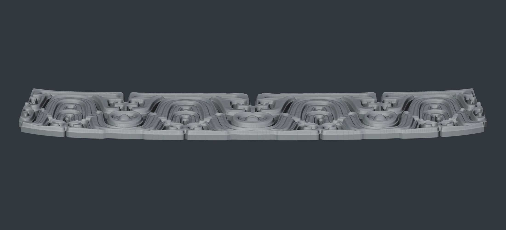
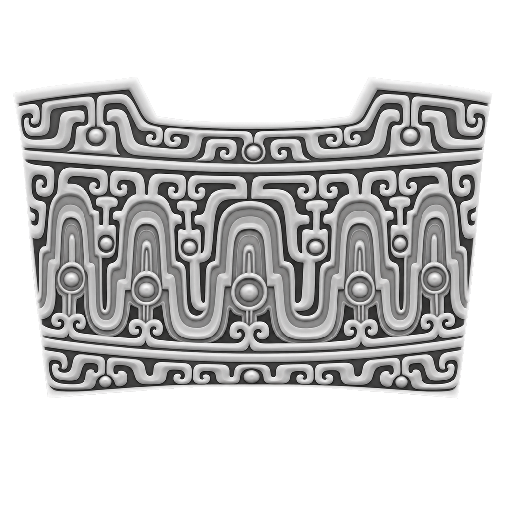
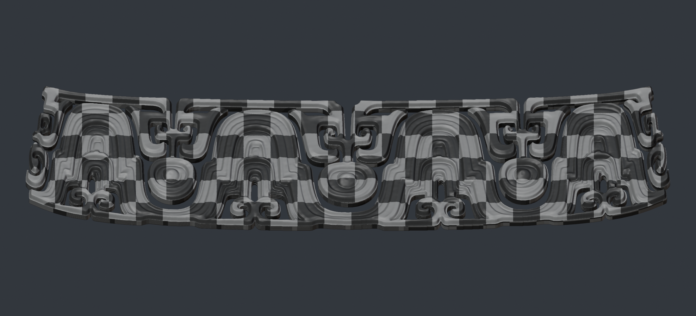

# 完整节点工作台项目包

**[打开完整 ZIP 文件页](photo-to-ornament-workflow-full.zip) · [SHA256 校验文件](photo-to-ornament-workflow-full.zip.sha256) · [项目主页与完整说明](../README.md)**

## 下载到本机

1. 登录有权访问此私有仓库的 GitHub 账号。
2. 打开上方 ZIP 文件页，点击 **Download raw file**，将约 **1.57 GB** 的文件保存到本机。
3. 完整解压，进入 `photo-to-ornament-workflow` 文件夹，阅读 `PACKAGE_START.md`。

完整 ZIP 使用 Git LFS 保存。包内保留当前源码、13 个节点、15 个历史版本、`CylinderPipe.obj`、Codex 生成图、UV / 密度资料和 Blender / FBX 产物。

## 已完成的效果图



| 鼎案例 · 浮雕正面 | 鼎案例 · 侧视厚度 |
| --- | --- |
|  |  |

| CylinderPipe · UV 纹样图 | 鼎案例 · UV 棋盘格 |
| --- | --- |
|  |  |

UV 纹样为白色遮罩范围内的二维输出；鼎案例图片为 Blender 5.2.2 渲染，保留原细节、底面、侧壁和 UV，正面浮雕系数为 0.5。

## 启动工作台

安装 **Python 3.12** 后，在解压的项目目录启动：

| 系统 | 启动方式 |
| --- | --- |
| Windows | 双击 `start_workbench.cmd` |
| Linux / macOS | 执行 `bash start_workbench.sh` |

首次启动会创建虚拟环境并安装依赖。服务启动后，在同一台电脑上打开 `http://localhost:8001/`。可编辑节点、调整纹样密度、读取 OBJ UV、查看历史版本和导出资料。

新 Blender 任务需另行安装 Blender，并将 `blender` 加入 PATH。图片生成通过 Codex 对话桥接，独立网页不能自行调用聊天中的图像工具；见 [生成说明](../canvas/CODEX_GENERATION.md)。迁移时保留整个 `runs/canvas-studio/`，它保存当前画板状态和历史资料。

## 完整性

完整包已逐文件校验、解压启动，并从 GitHub 回下载核对：

```text
文件大小：1,571,857,933 字节
SHA256：dda189640bf4cee47d2f8f9a44c94242c62cdab704ea00d4572e54d35ea8ce4d
```

解压后 `PACKAGE_MANIFEST.json` 提供包内逐文件校验值。包内不含软件安装本体、虚拟环境、Git 历史或账号凭证。本分支为 `download-node-studio-20261008`。
